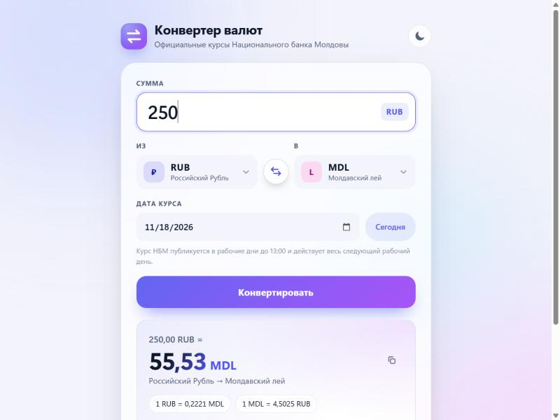

# Конвертер валют · официальные курсы НБМ

> **EN:** Currency converter with a local web GUI and the official exchange rates of the National
> Bank of Moldova. Python 3.10+ standard library only, SOLID layered architecture, works offline
> with a saved copy of the rates. Built spec-first with GitHub Spec Kit (see `specs/`).

Лабораторная работа №3: приложение с графическим интерфейсом, собранное по методике
spec-driven development. Спецификации Spec Kit лежат в [`specs/001-currency-converter`](specs/001-currency-converter),
конституция проекта — в [`.specify/memory/constitution.md`](.specify/memory/constitution.md).

| Светлая тема | Тёмная тема | Телефон |
|---|---|---|
|  |  |  |

## Возможности

- Конвертация между MDL и ~40 валютами по официальному курсу НБМ, в обе стороны и кросс-курсом.
- Курс на выбранную дату; выходные и неопубликованные даты — откат на последний курс с пояснением.
- Работа без интернета: последний успешный ответ хранится на диске и переживает перезапуск.
- Понятные сообщения о неверном вводе (отрицательная сумма, ноль, буквы, пустое поле, неверная дата).
- Точная арифметика `Decimal`, русский формат чисел `1 234,56`.
- Светлая и тёмная темы, поиск валют, управление с клавиатуры, адаптивная вёрстка от 360 px.

## Быстрый старт

Нужен только Python 3.10 или новее — сторонние пакеты для работы не требуются.

```powershell
python main.py
```

Откроется окно приложения (Edge/Chrome в режиме приложения или браузер по умолчанию).
В Windows можно просто дважды щёлкнуть `run.bat`. Остановка — `Ctrl+C` в окне консоли.

Подробная инструкция по эксплуатации: **[docs/USER_GUIDE.md](docs/USER_GUIDE.md)**.

### Параметры запуска

| Параметр | По умолчанию | Назначение |
|---|---|---|
| `--port` | `8765` | порт локального сервера (если занят — берётся следующий свободный) |
| `--host` | `127.0.0.1` | адрес сервера (только этот компьютер) |
| `--data-dir` | `%APPDATA%\CurrencyConverter` | папка для сохранённых курсов; также переменная `CURRENCY_CONVERTER_DATA_DIR` |
| `--source-url` | `https://www.bnm.md/ru/official_exchange_rates` | адрес XML-ленты НБМ |
| `--timeout` | `8` | таймаут запроса к НБМ, секунд |
| `--no-browser` | — | не открывать окно, только напечатать адрес |

Проверка работы без сети без отключения Wi-Fi: `python main.py --source-url http://127.0.0.1:9/`.

## Архитектура

```text
web (HTTP-сервер, JSON API, статический UI)
  └─► presentation (форматирование, русские тексты)
  └─► application (RateService: откат по датам, офлайн; ConverterService: сценарий конвертации)
        └─► domain (модели, Decimal-конвертер, валидация, календарь) — без ввода-вывода
        └─► ports (Protocol-интерфейсы) ◄── adapters (НБМ, HTTP, JSON-кэш, часы, браузер)
bootstrap.py — единственная точка сборки зависимостей
```

| Принцип | Где виден |
|---|---|
| SRP | парсер XML, HTTP-клиент, кэш, конвертер, валидатор, презентер и сервер — отдельные классы |
| OCP | новый источник курсов = новый `RateProvider`; кэш в памяти добавлен декоратором `MemoizingRateProvider` |
| LSP | любой `RateProvider` / `RateCache` подставляется без изменений сервиса (тесты используют подделки) |
| ISP | шесть маленьких протоколов в `ports.py` |
| DIP | сервисы получают абстракции через конструктор; конкретные классы создаёт только `bootstrap.py` |

## Структура репозитория

```text
main.py, run.bat               запуск
currency_converter/            код приложения (domain, application, adapters, presentation, web)
specs/001-currency-converter/  спецификация, план, исследование, модель данных, контракты, задачи, анализ
.specify/, .github/skills/     GitHub Spec Kit (конституция, шаблоны, команды для Copilot)
docs/                          инструкция пользователя, журнал работы агентов, скриншоты
REPORT.md                      отчёт по лабораторной работе
```

## Git

Ветки по этапам: `spec/currency-converter` → `feature/implementation` → `test/unit-tests` →
`docs/report`; в `main` — только через Pull Request с merge-коммитом. Сообщения коммитов в стиле
Conventional Commits: заголовок на английском, в теле описание на английском (`EN:`) и русском (`RU:`).
