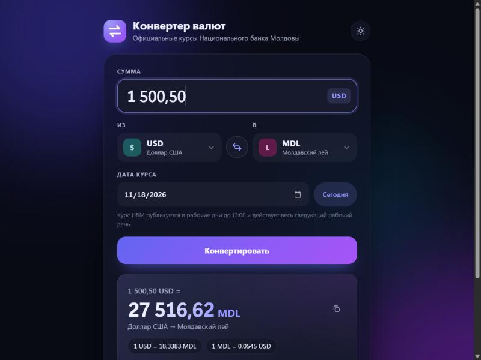
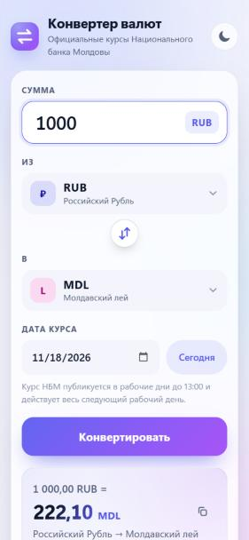

# Currency Converter · Official NBM Rates

**English** · [Русский](README.ru.md)

A desktop-style currency converter with a local web GUI, powered by the official exchange rates of
the **National Bank of Moldova** (NBM, bnm.md). It uses the Python 3.10+ standard library only, follows
a layered SOLID architecture and keeps working offline with a saved copy of the rates.

This is lab work #3 on **spec-driven development**: the application was specified first with
[GitHub Spec Kit](https://github.com/github/spec-kit) and then implemented from those specifications.
The Spec Kit artifacts live in [`specs/001-currency-converter`](specs/001-currency-converter), and the
project constitution is in [`.specify/memory/constitution.md`](.specify/memory/constitution.md).

> The user interface, the operating manual and the lab report are in Russian (the target audience).
> Code, identifiers, the API and git history are in English.

| Light theme | Dark theme | Phone |
|---|---|---|
|  |  |  |

## Features

- Converts between MDL and ~40 currencies at the official NBM rate, in both directions and via cross rates.
- Rate for any chosen date: weekends and unpublished dates fall back to the last published rate,
  and the app says which date is used and why.
- Works offline: the last successful response is saved to disk and survives restarts; the user
  explicitly opts in to the saved copy, which is always labelled with its rate date and save time.
- Clear messages for invalid input (negative amount, zero, letters, empty field, wrong date).
- Exact `Decimal` arithmetic and Russian number formatting (`1 234,56`).
- Light and dark themes, searchable currency pickers, full keyboard support, responsive down to 360 px.

## Quick start

Only Python 3.10 or newer is needed. No third-party packages are required to run the app.

```powershell
python main.py
```

The app window opens (Edge/Chrome in app mode, or your default browser). On Windows you can simply
double-click `run.bat`. Stop the app with `Ctrl+C` in the console window.

Full operating manual (in Russian): **[docs/USER_GUIDE.md](docs/USER_GUIDE.md)**.

### Command-line options

| Option | Default | Purpose |
|---|---|---|
| `--port` | `8765` | local server port (the next free port is used if it is busy) |
| `--host` | `127.0.0.1` | server address (this computer only) |
| `--data-dir` | `%APPDATA%\CurrencyConverter` | folder for the saved rates; also the `CURRENCY_CONVERTER_DATA_DIR` variable |
| `--source-url` | `https://www.bnm.md/ru/official_exchange_rates` | NBM XML feed URL |
| `--timeout` | `8` | NBM request timeout, seconds |
| `--no-browser` | — | do not open a window, only print the URL |

To try offline mode without turning off Wi-Fi: `python main.py --source-url http://127.0.0.1:9/`.

## Tests

Unit tests run with **one command** (only `pytest` is needed):

```powershell
python -m pip install -r requirements-dev.txt
python -m pytest
```

186 tests run in about 3 seconds without internet access. They use recorded NBM responses from
`tests/fixtures` and fake port implementations from `tests/conftest.py`.

| File | What it covers |
|---|---|
| `test_bnm_parser.py` | NBM XML parsing: real responses, nominals, empty answer, broken XML, HTML instead of XML |
| `test_bnm_provider.py` | request URL, 404 → "rate not published", other HTTP errors, the urllib client, in-memory cache |
| `test_conversion.py` | conversion both ways, cross rates, nominals, identical currencies, Decimal |
| `test_validation.py` | every amount and date format; rejection of negative, zero, non-numeric and empty amounts |
| `test_rate_service.py` | weekends, holidays, "not yet published", 10-day window, offline mode, saved copy |
| `test_json_cache.py` | save and load after a restart, atomic writes, corrupted files |
| `test_presentation.py` | Russian formatting, error messages and notices |
| `test_api.py` | the whole JSON API: 200/400/404/422/503/500 |

## Architecture

```text
web (HTTP server, JSON API, static UI)
  └─► presentation (formatting, Russian texts)
  └─► application (RateService: date fallback, offline; ConverterService: conversion use case)
        └─► domain (models, Decimal converter, validation, calendar) — no I/O
        └─► ports (Protocol interfaces) ◄── adapters (NBM, HTTP, JSON cache, clock, browser)
bootstrap.py — the single composition root
```

| Principle | Where it shows |
|---|---|
| SRP | the XML parser, HTTP client, cache, converter, validator, presenter and server are separate classes |
| OCP | a new rate source is a new `RateProvider`; the in-memory cache was added as the `MemoizingRateProvider` decorator |
| LSP | any `RateProvider` / `RateCache` can be swapped in without changing the service (tests use fakes) |
| ISP | six small protocols in `ports.py` |
| DIP | services receive abstractions through constructors; only `bootstrap.py` creates concrete classes |

## Repository layout

```text
main.py, run.bat               launchers
currency_converter/            application code (domain, application, adapters, presentation, web)
specs/001-currency-converter/  spec, plan, research, data model, contracts, tasks, analysis
.specify/, .github/skills/     GitHub Spec Kit (constitution, templates, Copilot commands)
docs/                          operating manual, agent log, screenshots, pull request notes
REPORT.md                      lab report (in Russian)
```

## Git workflow

One branch per stage: `spec/currency-converter` → `feature/implementation` → `test/unit-tests` →
`docs/report`. Changes reach `main` only through Pull Requests with merge commits:
[#1](https://github.com/JOHNSPEIAN/PSI-lab3-currency-converter/pull/1) specs,
[#2](https://github.com/JOHNSPEIAN/PSI-lab3-currency-converter/pull/2) implementation,
[#3](https://github.com/JOHNSPEIAN/PSI-lab3-currency-converter/pull/3) tests,
[#4](https://github.com/JOHNSPEIAN/PSI-lab3-currency-converter/pull/4) report.
Commit messages follow Conventional Commits: an English subject, and a body with an English (`EN:`)
and a Russian (`RU:`) description.

## Data source

Rates come from the official NBM XML feed,
`https://www.bnm.md/ru/official_exchange_rates?get_xml=1&date=DD.MM.YYYY`. NBM publishes rates on
business days (usually before 13:00 Chisinau time), and each rate applies for the whole next business
day. Dates without a published rate return an empty `404` response, which the app treats as
"rate not published".
