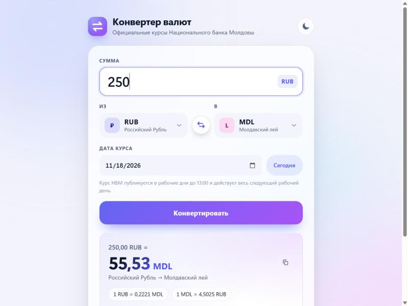
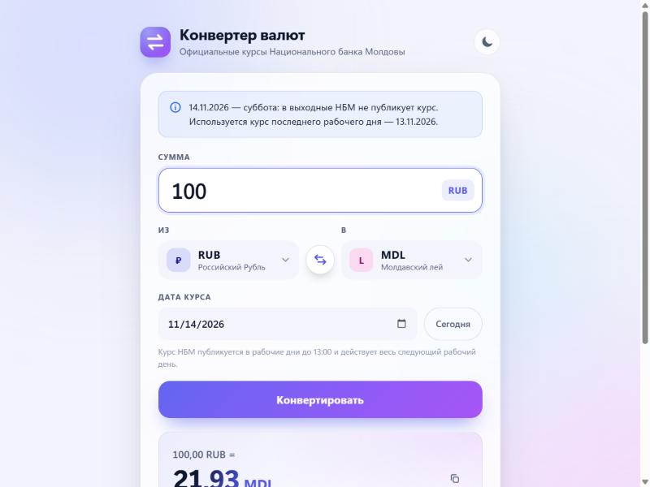
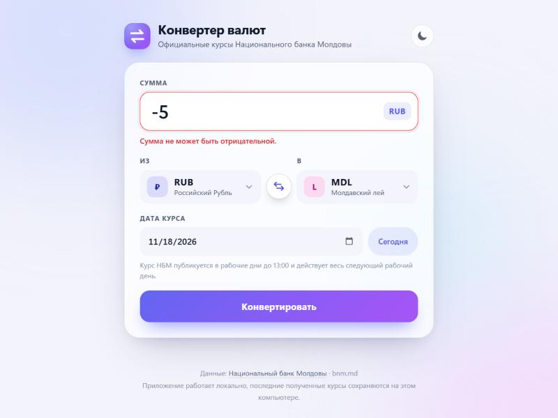
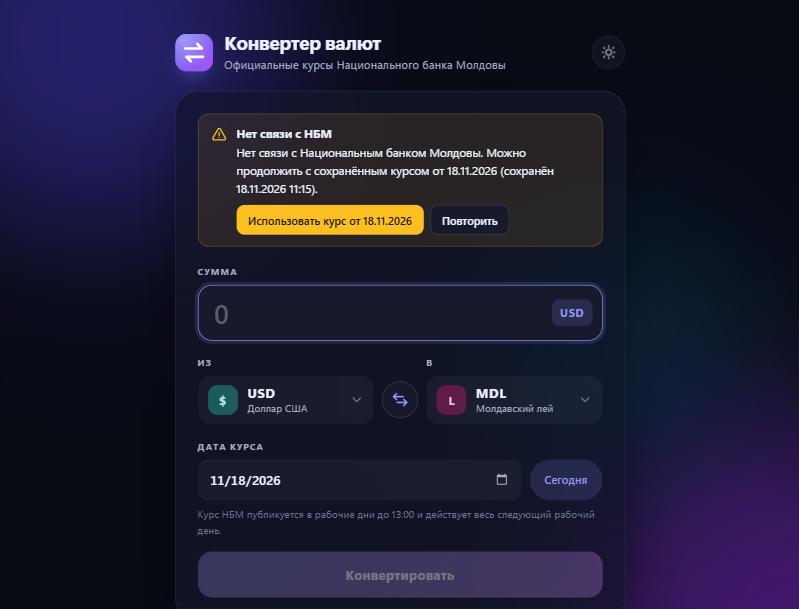
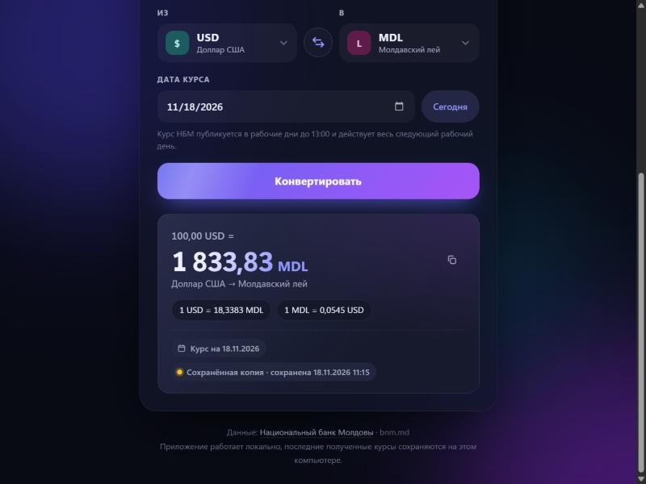

# Инструкция по эксплуатации: «Конвертер валют · НБМ»

Версия 1.0.0. Приложение переводит суммы между молдавским леем (MDL) и иностранными валютами по
официальному курсу Национального банка Молдовы (НБМ, bnm.md).

---

## 1. Требования

| Что | Минимум |
|---|---|
| Операционная система | Windows 10/11 (основная), Linux, macOS |
| Python | 3.10 или новее (`python --version`) |
| Браузер | Microsoft Edge или Google Chrome (рекомендуется), Firefox |
| Интернет | нужен для свежих курсов; без него работает сохранённая копия |
| Сторонние пакеты | не нужны (для тестов — только `pytest`) |

## 2. Установка

1. Установите Python с [python.org](https://www.python.org/downloads/). В Windows отметьте
   «Add python.exe to PATH».
2. Скопируйте папку проекта (или выполните `git clone <адрес репозитория>`).
3. Больше ничего ставить не нужно.

## 3. Запуск и остановка

**Windows:** дважды щёлкните `run.bat` в папке проекта.

**Любая система:** откройте терминал в папке проекта и выполните

```powershell
python main.py
```

В консоли появится:

```text
Конвертер валют 1.0.0 запущен: http://127.0.0.1:8765/
Сохранённые курсы: C:\Users\<вы>\AppData\Roaming\CurrencyConverter\rates-cache.json
Для остановки нажмите Ctrl+C.
```

и откроется окно приложения. Если окно не открылось — скопируйте адрес из консоли в браузер.

**Остановка:** закройте окно приложения и нажмите `Ctrl+C` в консоли (или закройте консоль).
Окно консоли нужно держать открытым, пока вы пользуетесь приложением: в нём работает локальный
сервер. Сервер доступен только с этого компьютера (`127.0.0.1`).

### Параметры командной строки

```powershell
python main.py --help
```

| Параметр | Пример | Когда нужен |
|---|---|---|
| `--port N` | `--port 9000` | порт 8765 занят другой программой (обычно не нужно: берётся следующий свободный) |
| `--data-dir ПАПКА` | `--data-dir D:\rates` | хранить сохранённые курсы в другой папке |
| `--no-browser` | | не открывать окно автоматически |
| `--timeout СЕК` | `--timeout 15` | очень медленный интернет |
| `--source-url URL` | `--source-url http://127.0.0.1:9/` | демонстрация работы без сети (недоступный адрес) |

## 4. Интерфейс



| № | Элемент | Назначение |
|---|---|---|
| 1 | **Сумма** | сколько денег перевести. Справа подсказан код исходной валюты |
| 2 | **Из** | валюта, которая у вас есть |
| 3 | **⇄** | поменять валюты местами (результат пересчитается сразу) |
| 4 | **В** | валюта, которую хотите получить |
| 5 | **Дата курса** | на какую дату брать официальный курс; по умолчанию — сегодня |
| 6 | **Сегодня** | вернуть сегодняшнюю дату одним нажатием |
| 7 | **Конвертировать** | выполнить расчёт; неактивна, пока не заполнены сумма, обе валюты и дата |
| 8 | **Результат** | итоговая сумма, кнопка копирования, курсы в обе стороны |
| 9 | **Метки** | дата курса, который реально применён, и источник данных |
| 10 | **☾ / ☀** | переключить тёмную/светлую тему (по умолчанию — как в системе) |

## 5. Как пользоваться

### 5.1. Обычная конвертация

1. Введите сумму, например `1500` или `1 500,50`. Подходят и точка, и запятая; пробелы между
   разрядами можно ставить.
2. Нажмите на список **Из** и выберите валюту. В списке есть поиск: начните вводить код (`eur`) или
   название (`евро`, `лей`). Стрелки ↑/↓ — перемещение, Enter — выбор, Esc — закрыть.
   Вверху — популярные валюты (MDL, EUR, USD, RON, UAH, RUB, GBP), справа у каждой — курс к лею.
3. Так же выберите валюту **В**.
4. Нажмите **Конвертировать** или Enter в поле суммы.

Результат показывает:
- `1 500,50 USD =` — что вы перевели;
- `27 516,62 MDL` — сколько получится (округление до копеек);
- `1 USD = 18,3383 MDL` и `1 MDL = 0,0545 USD` — курс в обе стороны;
- `Курс на 18.11.2026` и `Национальный банк Молдовы · bnm.md` — дата и источник.

Кнопка копирования рядом с суммой кладёт результат в буфер обмена.

### 5.2. Обратное направление и кросс-курсы

- Нажмите **⇄** — валюты поменяются местами, результат пересчитается автоматически.
- Можно переводить между двумя иностранными валютами (например EUR → USD): курс считается через лей
  по официальным курсам НБМ.
- Если выбрать одну и ту же валюту в обоих списках, ошибки не будет: результат равен сумме, курс 1.

После первого результата смена валют или даты пересчитывает его сразу. Если вы изменили **сумму**,
результат станет полупрозрачным с подсказкой — нажмите Enter или «Конвертировать».

### 5.3. Курс на другую дату

Выберите дату в поле **Дата курса** (с 01.01.2000 до завтрашнего дня).

| Ситуация | Что сделает приложение |
|---|---|
| Рабочий день с опубликованным курсом | применит курс этой даты |
| Суббота или воскресенье | возьмёт курс последнего рабочего дня (пятницы) и сообщит об этом синим баннером |
| Праздник или день без публикации | откатится на ближайший более ранний день с курсом (не дальше 10 дней) и назовёт обе даты |
| Завтра, курс ещё не вышел | возьмёт сегодняшний курс и напомнит, что НБМ публикует курс обычно после 13:00 по Кишинёву |
| За 10 дней курсов нет | покажет ошибку и предложит выбрать другую дату |



### 5.4. Ошибки ввода

Неверное поле подсвечивается красным, под ним появляется пояснение, прежний результат скрывается —
конвертация не выполняется.

| Ввод | Сообщение |
|---|---|
| пусто | кнопка неактивна; при попытке — «Введите сумму.» |
| `0` | «Сумма должна быть больше нуля.» |
| `-5` | «Сумма не может быть отрицательной.» |
| `abc`, `12a`, `1,2,3` | «Сумма должна быть числом, например 1500 или 1 500,50.» |
| `1,23456` | «Не больше 4 знаков после запятой.» |
| больше 1 000 000 000 000 | «Слишком большая сумма…» |
| дата позже завтрашней | «Курс на эту дату ещё не опубликован…» |



## 6. Работа без интернета

После каждого успешного обращения к НБМ приложение сохраняет полученные курсы на диск
(файл `rates-cache.json` в папке данных, см. раздел 7). Копия сохраняется между запусками.

**Если сеть пропала и сохранённые курсы есть.** Приложение не закрывается. Появляется жёлтый
баннер «Нет связи с НБМ» с датой курса и временем сохранения и две кнопки:

- **Использовать курс от ДД.ММ.ГГГГ** — включить офлайн-режим и посчитать по сохранённой копии;
- **Повторить** — ещё раз обратиться к НБМ.



В офлайн-режиме вверху остаётся баннер «Офлайн-режим», а у результата — жёлтая метка
«Сохранённая копия · сохранена …». Кнопка **Попробовать онлайн** возвращает к свежим данным.



**Если сети нет и сохранённых курсов ещё не было** (самый первый запуск без интернета) — вместо
формы показывается экран «Курсы пока недоступны» с кнопкой **Повторить**.

## 7. Где хранятся данные

| Система | Папка |
|---|---|
| Windows | `%APPDATA%\CurrencyConverter\` (например `C:\Users\Иван\AppData\Roaming\CurrencyConverter\`) |
| Linux / macOS | `~/.local/share/currency-converter/` |

Точный путь печатается в консоли при запуске. Файл `rates-cache.json` можно безопасно удалить —
приложение создаст его снова при следующем успешном обращении к НБМ. Повреждённый файл
игнорируется (приложение не падает). Тема и последняя выбранная пара валют запоминаются в браузере.

## 8. Тесты

```powershell
python -m pip install -r requirements-dev.txt
python -m pytest
```

Тесты не обращаются к интернету: используются записанные ответы НБМ и подставные объекты.

## 9. Решение проблем

| Проблема | Решение |
|---|---|
| `python` не найден | установите Python и отметьте «Add to PATH», или запускайте `py main.py` |
| Окно не открылось | откройте адрес из консоли вручную в браузере |
| «Приложение не отвечает…» | закрыта консоль с сервером — запустите `run.bat` / `python main.py` снова |
| Всегда «Нет связи с НБМ» | проверьте интернет и доступность https://www.bnm.md; при медленной сети — `--timeout 15` |
| Порт занят | приложение само возьмёт следующий свободный порт; адрес смотрите в консоли |
| Курс не совпадает с банком | приложение показывает **официальный** курс НБМ, а не курс покупки/продажи коммерческих банков |
| В консоли «кракозябры» | приложение переключает консоль на UTF-8; в старой `cmd` выполните `chcp 65001` |

## 10. Об источнике данных

Курсы берутся из официальной XML-ленты НБМ:
`https://www.bnm.md/ru/official_exchange_rates?get_xml=1&date=ДД.ММ.ГГГГ`.
НБМ публикует курс в рабочие дни (обычно до 13:00 по времени Кишинёва), и он действует весь
следующий рабочий день. Для дат без публикации лента отвечает пустым ответом (HTTP 404) — приложение
обрабатывает это как «курс не опубликован».
